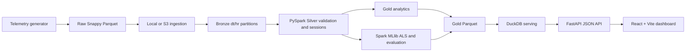

# Architecture

This file describes the implemented local-first workflow and optional cloud mode. The design assets referenced in the initial plan were not present in the repository.

## Pipeline (data flows top to bottom)

1. **Data Generation** (Fidal) — Python simulator; Zipfian title popularity; realistic sessions.
2. **Ingestion** (Fidal) — local or Boto3 batches → Snappy Parquet → content-addressed Bronze partitions.
3. **Silver** (Lubaba) — PySpark contract enforcement, invalid-row reporting, event dedupe, sessions, and five-minute windows.
4. **Gold** (Lubaba) — analytics plus Spark MLlib implicit ALS, ranking evaluation, and popularity fallback.
5. **Serving** (Adithyan) — DuckDB reads Gold Parquet; FastAPI exposes read-only JSON endpoints to the React + Vite dashboard.

**Cross-cutting:** explicit batch orchestration · least-privilege IAM / environment configuration · frozen data contracts.

## Key decisions

- **Infra:** local-first; optional AWS S3 and Databricks. No cloud services are mandatory locally.
- **Processing model:** near-real-time **micro-batch** (honest framing of "real-time").
- **Storage:** Parquet is the implemented local interchange format. Delta Lake has not been wired in.
- **Scale:** ~10k users × ~1k titles → several million events.
- **Recommender:** ALS implicit feedback, evaluated with ranking metrics (precision@k, NDCG).

## Decision log

- 2026-10-12 — reframed "real-time" as near-real-time micro-batch; chose hybrid infra; Delta across all layers. (initial plan)
- 2026-10-19 — implemented the local-first Parquet workflow; managed Delta/Databricks orchestration remain future cloud work and are not claimed as tested.
- _add new design calls below as they happen_

## Local execution flow

ETL and model training are explicit batch commands; the API only queries exported Gold data. React receives HTTP responses, never local files or cloud credentials.

## Web application deployment

The Vite frontend can be hosted as a static site. FastAPI requires Gold Parquet on persistent backend storage or an operator-managed data sync. DuckDB currently reads local filesystem paths; it does not read Gold directly from S3. See [docs/DEPLOYMENT.md](docs/DEPLOYMENT.md).
The Vite frontend can be hosted as a static site. FastAPI requires Gold Parquet on persistent backend storage or an operator-managed data sync. DuckDB currently reads local filesystem paths; it does not read Gold directly from S3. See [docs/DEPLOYMENT.md](docs/DEPLOYMENT.md).

## Web application deployment

The frontend can be hosted as a static Vite build; the FastAPI process needs access to Gold Parquet on a persistent disk or via an operator-managed data sync. The current DuckDB serving layer reads local filesystem paths; it does not read Gold data directly from S3. See [docs/DEPLOYMENT.md](docs/DEPLOYMENT.md).
