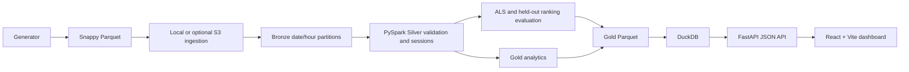

# StreamPulse Architecture

The repository's original architecture record is maintained at [../ARCHITECTURE.md](../ARCHITECTURE.md). This implementation uses local-first micro-batches; local/S3 Parquet Bronze is processed by PySpark into Silver and Gold Parquet. Spark MLlib ALS trains and evaluates recommendations as an explicit batch operation. DuckDB queries exported Gold datasets through FastAPI for a React + Vite dashboard.

Delta Lake, continuous streaming, managed orchestration, and cloud deployment are not implemented or verified. Cloud mode does not create resources. Refer to [AWS setup](AWS_SETUP.md) and [Databricks setup](DATABRICKS_SETUP.md) for the current boundary.

FastAPI uses `GoldStore` DuckDB methods and never invokes Spark. The React application uses fetch-based HTTP calls only. In production, an operator must publish Gold Parquet and the catalogue to persistent backend storage; direct S3-backed DuckDB queries are not implemented.

Routes and response envelopes are documented in [API.md](API.md).